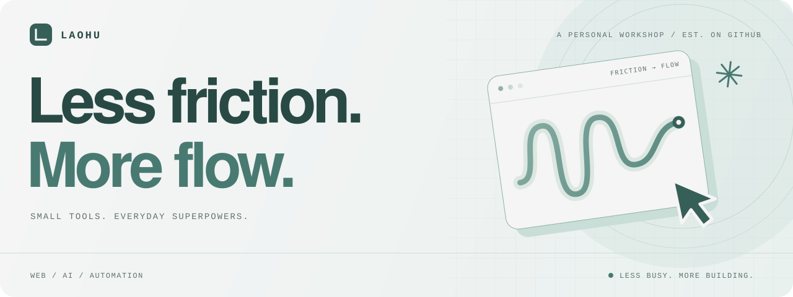

<p align="center">
  
</p>

<p align="center">
  <strong>你好，我是老胡。给生活写点外挂。</strong><br />
  写一点代码，省一点折腾。把每天遇到的小麻烦，做成真正用得上的工具。
</p>

<p align="center">
  <a href="#正在折腾">正在折腾</a> &nbsp; / &nbsp;
  <a href="#一些作品">一些作品</a> &nbsp; / &nbsp;
  <a href="https://github.com/laohubb?tab=repositories">全部仓库 ↗</a>
</p>

---

### 正在折腾

**AI 工具 × 浏览器脚本 × 本地优先的小应用**

把 AI 接进顺手的工作流，让浏览器少绕几个弯，让数据尽量留在自己手里。喜欢小而直接的产品：打开就能用，用完就能走。

```text
日常不顺手的地方  →  写个工具  →  自己用起来  →  慢慢打磨
```

### 一些作品

<table>
  <tr>
    <td valign="top" width="50%">
      <h3>01 / 划一下，就懂了</h3>
      <p><a href="https://github.com/laohubb/bob-plugin-kimi-translator"><strong>Bob · Kimi &amp; Magpie</strong> ↗</a></p>
      <p>把 AI 接到 macOS 划词翻译里。流式翻译、原文润色、自定义 Prompt，放进同一个顺手动作。</p>
      <p><sub>JavaScript · Bob · AI</sub></p>
    </td>
    <td valign="top" width="50%">
      <h3>02 / 存款还能撑多久？</h3>
      <p><a href="https://github.com/laohubb/savings-runway-calculator"><strong>存款续航计算器</strong> ↗</a></p>
      <p>调整本金、支出和利率，看看不同生活方案的资金续航。纯静态网页，设置保存在浏览器。</p>
      <p><sub>HTML · 情景测算 · 本地保存</sub></p>
    </td>
  </tr>
  <tr>
    <td valign="top" width="50%">
      <h3>03 / 想到，就记下来</h3>
      <p><a href="https://github.com/laohubb/letsdo"><strong>Let's Do</strong> ↗</a></p>
      <p>一个纯本地的待办清单。单条添加、批量录入、完成再划掉，把注意力留给要做的事。</p>
      <p><sub>Vue 3 · Vite · Tailwind CSS</sub></p>
    </td>
    <td valign="top" width="50%">
      <h3>04 / 搜索，少绕点路</h3>
      <p><a href="https://github.com/laohubb/googleMore"><strong>GoogleMore</strong> ↗</a></p>
      <p>在 Google 搜索页加上更多搜索引擎入口。一个小脚本，省下反复打开页面、重新输入的动作。</p>
      <p><sub>JavaScript · Tampermonkey · 浏览器</sub></p>
    </td>
  </tr>
</table>

再往前翻，还有 [Sakula UI](https://github.com/laohubb/sakula-ui)：用 Vue 3 做的组件库，从按钮、开关到弹窗，练习把界面的细节做完整。

### 工具箱

`Vue` · `TypeScript` · `JavaScript` · `Vite` · `Tailwind CSS` · `Git`

技术按问题选。能用一个网页解决，就先把那个网页做好。

---

<p align="center">
  <strong>少点重复，多点自由。</strong><br />
  <sub>Small tools. Real problems. A little more freedom.</sub>
</p>
